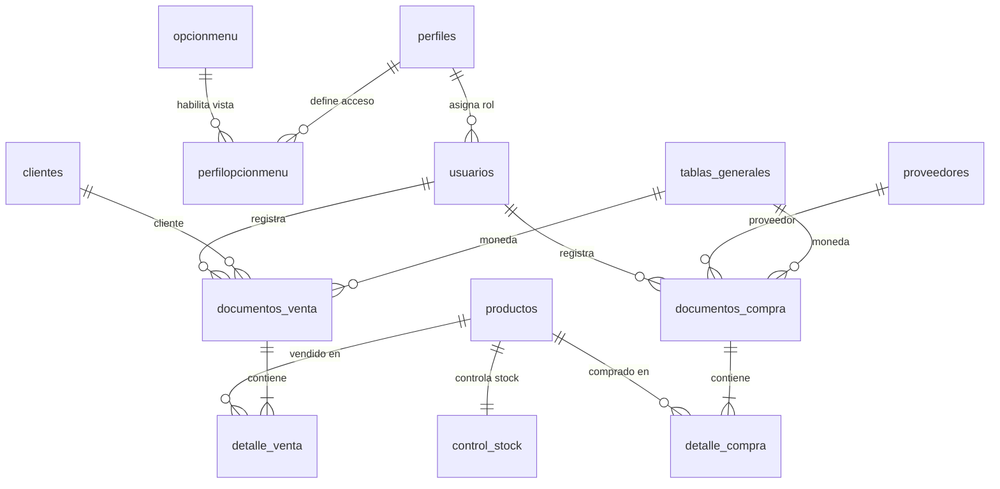

# Informe Final de Proyecto: CaseroYa - Sistema de Gestión de Inventarios y Ventas (Backend)

## 1. Portada
- **Título del Proyecto:** CaseroYa - Solución Integral de Inventario y Ventas para Negocios Minoristas
- **Nombre del Curso:** CS 2031 Desarrollo Basado en Plataformas
- **Periodo Académico:** 2026-2
- **Integrantes del Equipo:**
    - Adrian Omar Cespedes Llanos – 202510675
    - Enzo Mathias Calderon Soto – 202510032
    - Juan Diego Lama Flor – 202410401
    - Misael Osvaldo Aquino Hidalgo – 202510626
    - Victor Paolo Soto Ruiz – 202510343

---

## 2. Índice
1. Portada
2. Índice
3. Introducción
4. Identificación del Problema o Necesidad
5. Descripción de la Solución
6. Modelo de Entidades y Datos
7. Arquitectura y Patrones de Diseño
8. Manejo de Errores y Excepciones
9. Medidas de Seguridad Implementadas
10. Eventos y Asincronía
11. GitHub & Project Management
12. Instrucciones de Despliegue y Ejecución
13. Conclusión
14. Apéndices

---

## 3. Introducción

### Contexto
El entorno actual del comercio minorista, particularmente en el sector de las bodegas, minimarkets y negocios familiares en la región, se encuentra en una etapa de transición tecnológica. Muchos de estos negocios aún dependen de procesos manuales, utilizando cuadernos o rudimentarias hojas de cálculo en Excel para registrar sus ventas diarias, gestionar sus compras y llevar un control de su inventario. Esta dependencia en herramientas no especializadas genera ineficiencias significativas, propensión a errores humanos, pérdida de información y una incapacidad para tomar decisiones financieras basadas en datos reales y actualizados.

### Objetivos del Proyecto
El objetivo principal de CaseroYa es desarrollar e implementar un backend robusto, escalable y seguro basado en la arquitectura de micro-servicios modulares (Domain-Driven Design) que permita la digitalización completa de las operaciones de un negocio minorista.
Los objetivos específicos incluyen:
- Desarrollar un módulo de seguridad basado en roles (RBAC) y autenticación JWT.
- Automatizar el registro de entradas y salidas de mercancía mediante un control transaccional del stock respaldado por funciones PL/pgSQL en PostgreSQL.
- Generar reportes de ventas y compras en tiempo real filtrados por rangos de fechas.
- Notificar eventos críticos del sistema mediante servicios asíncronos y correos electrónicos.

---

## 4. Identificación del Problema o Necesidad

### Descripción del Problema
A través de un análisis del mercado local, se identificó que el principal problema de los dueños de negocios minoristas es la **"pérdida fantasma"** o merma no detectada. Al no tener un sistema centralizado que vincule automáticamente una venta en la caja con la reducción del stock en el almacén, los dueños no pueden detectar a tiempo faltantes, productos agotados o errores en el cobro. Además, el cierre de caja diario se convierte en un proceso tedioso de varias horas donde el descuadre de inventario ocurre con frecuencia.

### Justificación
Automatizar y centralizar este proceso a través de una API RESTful elimina los errores de cálculo humano (como el cálculo manual del IGV del 18%) y ahorra hasta un 40% del tiempo administrativo del negocio. Proveer una solución en la nube (con base de datos administrada en Supabase y servidor contenedorizado en Render) permite al dueño del negocio monitorear las transacciones y el inventario desde cualquier lugar en tiempo real.

---

## 5. Descripción de la Solución

### Funcionalidades Implementadas
La solución construida abarca un ecosistema completo dividido en 5 módulos principales desarrollados por el equipo:

1. **Gestión de Identidad y Accesos (IAM):** 
   - Autenticación mediante JSON Web Tokens (JWT).
   - Encriptación de contraseñas utilizando el algoritmo BCrypt.
   - Gestión de perfiles (`ADM`, `CAJ`, `GER`, `DUE`) y mapeo de opciones de menú dinámicas.
2. **Catálogos Core:** 
   - Mantenimiento completo (CRUD) de la cartera de Clientes y Proveedores.
   - Implementación de una Tabla General parametrizada para manejar variables del sistema (Tipos de Moneda, Tipos de Documento, Tipos de Comprobante) sin alterar la estructura física de la base de datos.
3. **Gestión de Inventario (Almacén):** 
   - Registro, edición y baja lógica de productos con categorías y unidades de medida.
   - Control de Stock utilizando funciones almacenadas PL/pgSQL (`fn_productos_*` y `fn_control_stock_*`) e invocaciones mediante `JdbcTemplate` para garantizar atomicidad en el aumento y disminución de existencias.
4. **Sistema de Ventas (Punto de Venta):** 
   - Generación de Documentos de Venta con múltiples Detalles de Venta en cascada.
   - Cálculo automático de subtotales, impuestos (IGV 18%) y montos totales.
   - Anulación de ventas con reversión automática del stock al almacén.
   - Generación de reportes financieros filtrados por rangos de fechas (`/api/reportes/ventas`).
5. **Sistema de Compras (Abastecimiento):**
   - Registro de documentos de compra a proveedores.
   - Integración directa con el módulo de Inventario para incrementar el stock automáticamente al registrar el ingreso de mercadería.

### Tecnologías Utilizadas
- **Lenguaje Base:** Java 17
- **Framework Principal:** Spring Boot
- **Persistencia de Datos:** Spring Data JPA, Hibernate, Spring JDBC Template.
- **Base de Datos:** PostgreSQL alojada en la nube mediante **Supabase** (con esquema unificado y funciones PL/pgSQL en `supabase_caseroya_completo.sql`).
- **Seguridad:** Spring Security, JSON Web Token (`jjwt`).
- **Asincronía y Tareas:** Spring `@Async`, `ThreadPoolTaskExecutor`.
- **Notificaciones:** `JavaMailSender` (Integración SMTP).
- **Documentación de API:** Springdoc OpenAPI (Swagger UI).
- **Validaciones:** Jakarta Bean Validation (`spring-boot-starter-validation`).
- **Contenedorización y Despliegue:** Docker multi-etapa desplegado en **Render**.

---

## 6. Modelo de Entidades y Datos

El modelo de base de datos fue diseñado siguiendo los principios de la tercera forma normal (3NF) para evitar redundancias, asegurando la integridad referencial mediante llaves foráneas y restricciones únicas (`UNIQUE`, `NOT NULL`).

### Diagrama Entidad-Relación



### Entidades Principales y Relaciones
1. **Módulo de Seguridad:**
   - `Usuario` (`usuarios`): Representa a los operadores y administradores del sistema. Relacionado con `Perfil`.
   - `Perfil` (`perfiles`): Define el rol del usuario (`ADM`, `CAJ`, `GER`, `DUE`).
   - `OpcionMenu` (`opcionmenu`) y `PerfilOpcionMenu` (`perfilopcionmenu`): Define las opciones de navegación accesibles según el perfil.
2. **Módulo Comercial:**
   - `Cliente` (`clientes`): Datos de identificación y contacto de los clientes.
   - `Proveedor` (`proveedores`): Datos de las empresas proveedoras con validación de RUC.
   - `TablaGeneral` (`tablas_generales`): Catálogo paramétrico para monedas (`PEN`, `USD`), tipos de documento (`DNI`, `RUC`, `CE`) y tipos de comprobante.
3. **Módulo de Inventario:**
   - `Producto` (`productos`): Entidad maestra del catálogo con precios de compra y venta.
   - `ControlStock` (`control_stock`): Existencias actuales en tiempo real vinculadas 1:1 con cada producto.
4. **Módulo de Transacciones (Ventas y Compras):**
   - `DocumentoVenta` (`documentos_venta`) y `DetalleVenta` (`detalle_venta`): Cabecera e ítems de cada operación de venta.
   - `DocumentoCompra` (`documentos_compra`) y `DetalleCompra` (`detalle_compra`): Cabecera e ítems de cada ingreso de mercadería.

---

## 7. Arquitectura y Patrones de Diseño

El backend se construyó sobre los cimientos del **Domain-Driven Design (DDD)** adaptado a una organización **Package-by-Feature**.

### Separación de Capas
Cada módulo de negocio (`venta`, `compra`, `auth`, `producto`, `stock`, `cliente`, `proveedor`, `usuario`, `perfil`, `opcionmenu`, `tablageneral`) está estructurado en sus propias capas internas:
- **`application`:** Contiene los Controladores REST (`@RestController`) que reciben las solicitudes HTTP y delegan la ejecución al dominio.
- **`domain`:** Contiene las Entidades (`@Entity` / `record`), Eventos de Dominio y Servicios (`@Service`) donde reside la lógica de negocio.
- **`infrastructure`:** Contiene los Repositorios (`@Repository` de Spring Data JPA y `JdbcTemplate`) encargados de la comunicación con PostgreSQL en Supabase.
- **`dto`:** Objetos de Transferencia de Datos (`RequestDto`, `ResponseDto`) para desacoplar el contrato de la API del modelo de persistencia.

### Patrones Aplicados
- **Principio de Responsabilidad Única (SRP):** Cada controlador, servicio y repositorio cumple un único propósito dentro de su dominio.
- **Inyección de Dependencias (DI):** Bajo acoplamiento entre componentes administrados por el contenedor de inversión de control de Spring.
- **Patrón Observer (Eventos de Dominio):** Uso de `ApplicationEventPublisher` y `@EventListener` para reaccionar a transacciones sin acoplar servicios secundarios.

---

## 8. Manejo de Errores y Excepciones

Para garantizar respuestas claras y estandarizadas ante cualquier fallo, se implementó un manejador centralizado con `@RestControllerAdvice` (`GlobalExceptionHandler.java`) e `InventarioExceptionHandler.java`.

Todas las excepciones capturadas retornan una estructura JSON uniforme (`ErrorResponseDto`):
- `timestamp`: Fecha y hora del evento.
- `status`: Código de estado HTTP (`400`, `401`, `403`, `404`, `409`, `500`).
- `error`: Descripción estándar del estado HTTP.
- `message`: Mensaje claro para el cliente consumidor.
- `path`: Endpoint invocado.

**Excepciones Personalizadas Implementadas:**
1. `RecursoNoEncontradoException` (HTTP 404)
2. `UsuarioNoEncontradoException` (HTTP 404)
3. `CredencialesInvalidasException` (HTTP 401)
4. `InvalidOperationException` / `OperacionInvalidaException` (HTTP 400 / 403)
5. `InsufficientStockException` / `StockInsuficienteException` (HTTP 409)
6. `BusinessRuleException` (HTTP 400)
7. `InvalidDataException` (HTTP 400)

---

## 9. Medidas de Seguridad Implementadas

El sistema integra **Spring Security** con política de sesión `STATELESS`.

### Seguridad de Datos
- **Cifrado de Contraseñas:** Uso de `BCryptPasswordEncoder` (factor de costo 10) para almacenar hashes seguros en la base de datos.
- **Autenticación Stateless con JWT:** Al iniciar sesión en `/api/auth/login`, `JwtService` firma un token con algoritmo `HS256` empleando una clave secreta de 384 bits (`JWT_SECRET`) inyectada por variables de entorno, incluyendo el código de usuario y su rol en los *claims*.

### Prevención de Vulnerabilidades
- **Control de Acceso Basado en Roles (RBAC):** Se habilitó `@EnableMethodSecurity`. El filtro `JwtAuthenticationFilter` valida la firma y expiración del token en cada petición y registra las autoridades (`ROLE_ADM`, `ROLE_ADMIN`, `ROLE_CAJERO`) en el `SecurityContextHolder`.
- **Configuración CORS:** `SecurityConfig` define los orígenes, encabezados (`Authorization`, `Content-Type`) y métodos HTTP (`GET`, `POST`, `PUT`, `PATCH`, `DELETE`, `OPTIONS`) permitidos para la integración con los clientes Web y Mobile.

---

## 10. Eventos y Asincronía

Para optimizar los tiempos de respuesta en operaciones transaccionales, el proyecto implementa una arquitectura dirigida por eventos junto con ejecución asíncrona.

- **Configuración de Pool de Hilos:** En `AsyncConfig.java` se habilita `@EnableAsync` con un `ThreadPoolTaskExecutor` dedicado (`CaseroyaAsync-`).
- **Eventos de DominioImplementados:**
  - `VentaCreadaEvent` / `VentaRealizadaEvent`: Emitidos al confirmar una venta para disparar tareas de auditoría y notificación sin bloquear la respuesta HTTP al cajero.
  - `StockBajoEvent`: Emitido cuando las existencias de un producto descienden a niveles críticos tras una venta.
  - `UsuarioCreadoEvent`: Emitido en el alta de nuevos usuarios.

---

## 11. GitHub & Project Management

- **Flujo de Ramas:** Se trabajó mediante ramas por funcionalidad e integración continua sobre la rama principal `main`, manteniendo archivos sensibles excluidos a través de `.gitignore`.
- **Trazabilidad:** Commits descriptivos siguiendo convenciones semánticas (`feat:`, `fix:`, `docs:`).
- **Organización:** Distribución modular de los paquetes de dominio entre los 5 integrantes del equipo.

---

## 12. Instrucciones de Despliegue y Ejecución

### Requisitos Previos
- Java JDK 17+
- Maven (o wrapper `./mvnw` incluido)
- Base de datos PostgreSQL (Local o en Supabase ejecutando `supabase_caseroya_completo.sql`)

### Pasos para Ejecutar en Local
1. **Clonar el repositorio:**
   ```bash
   git clone https://github.com/misaelaquinoutec/Proyecto_CaseroYa.git
   cd caseroya
   ```
2. **Configurar variables de entorno (`.env`):**
   ```env
   DB_URL=jdbc:postgresql://<HOST_SUPABASE>:5432/postgres?sslmode=require&prepareThreshold=0
   DB_USER=postgres.<PROJECT_REF>
   DB_PASSWORD=<TU_PASSWORD>
   JWT_SECRET=<CLAVE_BASE64_MINIMO_256_BITS>
   ```
3. **Compilar y ejecutar:**
   ```bash
   ./mvnw spring-boot:run
   ```
4. **Documentación Interactiva (Swagger UI):**
   - Local: `http://localhost:8080/swagger-ui/index.html`
   - Producción: [https://proyecto-caseroya-cr2n.onrender.com/swagger-ui/index.html](https://proyecto-caseroya-cr2n.onrender.com/swagger-ui/index.html)

---

## 13. Conclusión

### Logros del Proyecto
CaseroYa entrega una plataforma backend empresarial, desacoplada y desplegada en la nube (Render + Supabase) que resuelve el descontrol de inventario y facturación en negocios minoristas. La combinación de JPA para transacciones relacionales y funciones PL/pgSQL para operaciones críticas de inventario garantiza consistencia, velocidad y seguridad de extremo a extremo.

### Aprendizajes Clave
El desarrollo permitió consolidar el diseño de arquitecturas modulares orientadas al dominio, el manejo centralizado de errores, la autenticación sin estado mediante JWT, la ejecución de procesos asíncronos con eventos de Spring y el despliegue en contenedores Docker en entornos cloud de producción.

### Trabajo Futuro
- Integración con facturación electrónica SUNAT (envío automático de XML/CDR).
- Alertas automatizadas de reabastecimiento a proveedores cuando se dispare `StockBajoEvent`.
- Panel de analítica predictiva de demanda por temporada.

---

## 14. Apéndices

- **Licencia:** MIT License.
- **Colección Postman:** Archivo [`postman_collection.json`](./postman_collection.json) ubicado en la raíz del repositorio.
- **Script de Base de Datos Supabase:** Archivo [`supabase_caseroya_completo.sql`](./supabase_caseroya_completo.sql).
- **URL de Producción (Render):** [https://proyecto-caseroya-cr2n.onrender.com](https://proyecto-caseroya-cr2n.onrender.com)
- **Swagger UI en Producción:** [https://proyecto-caseroya-cr2n.onrender.com/swagger-ui/index.html](https://proyecto-caseroya-cr2n.onrender.com/swagger-ui/index.html)
